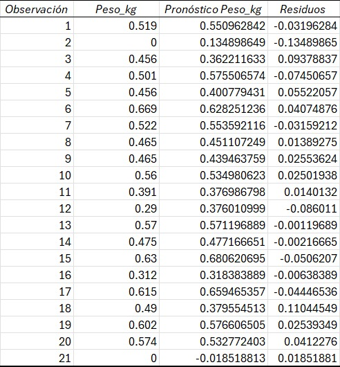

```{=html}
<style>
/* 1. Títulos del texto principal (Área de lectura) */
h1, h2, h3, h4, h5, h6, .title { 
  color: #2E7D32 !important; 
}

/* 2. Fondo de la caja superior izquierda */
#sidebar h2 { 
  background-color: #2E7D32 !important; 
}

/* 3. LA SOLUCIÓN: Fuerza el texto del título a blanco puro */
#sidebar h2 a { 
  color: #FFFFFF !important; 
}

/* 4. Textos inactivos del menú lateral (Gris claro para contraste) */
#sidebar ul li a { 
  color: #E0E0E0 !important; 
}

/* 5. Pestaña activa del menú (Fondo blanco, letra verde) */
#sidebar .nav > .active > a, 
#sidebar .nav > .active:hover > a, 
#sidebar .nav > .active:focus > a {
  color: #2E7D32 !important;
  background-color: #FFFFFF !important;
  border-left: 3px solid #2E7D32 !important;
}

/* 6. Botón de menú en teléfonos móviles */
.navbar-toggle .icon-bar { 
  background-color: #2E7D32 !important; 
}

/* 1. Forzar salto de línea y alineación en el título verde */
#sidebar h2, #sidebar h2 a {
  white-space: normal !important;
  word-wrap: break-word !important;
  text-align: left !important;
  line-height: 1.3 !important;
}

/* 2. Forzar salto de línea en las opciones del menú inferior */
#sidebar ul li a {
  white-space: normal !important;
  word-wrap: break-word !important;
  line-height: 1.3 !important;
  padding-right: 10px !important; /* Evita que el texto pegue justo en el borde gris */
}

body {
  background-color: #FCFCFC !important;
}
</style>
```

# Localización de sitios de muestreo

A continuación, se exponen diferentes métodos para localizar veinte (21) sitios de observación en campo, para que posteriormente se logre la estimación de los rendimientos del cultivo de maíz en área bajo estudio.

```{r, echo=FALSE, include=FALSE}
library(sp); library(sf); library(raster); library(terra); library(leaflet); library(tidyverse); library(rmarkdown); library(sgsR); library(clhs); library(ggplot2); library(mapview)
paleta_semaforo <- colorRampPalette(c("red", "orange", "yellow", "green3"))
color_fijos4<- c("green3", "yellow", "orange", "red")
```

### Área de estudio

El área de estudio se encuentra en el estado Portuguesa y posee una superficie de 94.96 ha, además está dividida en 4 lotes.

```{r, warning = FALSE, echo=FALSE}
perimetro<- shapefile("Camburito_Acarigua1.shp")
perimetro_sf<- st_as_sf(perimetro)
ggplot(perimetro_sf) +
  geom_sf(fill= "lightgreen", color="darkgreen", lwd=1) +
  labs(title="Area de estudio",
       x = "Longitud",
       y = "Latitud") +
  theme(axis.text.x = element_text(angle = 45, hjust = 1)) +
  scale_x_continuous(n.breaks = 4, labels = function(x) round(x, 1))
```

### 1.- Muestreo Aleatorio

Es un método estadístico de selección donde cada elemento de una población (celda) tiene exactamente la misma probabilidad de ser elegido. Al realizarse de manera completamente al azar, se eliminan los sesgos humanos, garantizando que la muestra obtenida sea una representación objetiva y válida del grupo total.

```{r, echo=2:4}
set.seed(0212)
muestra_aleatoria<- spsample(perimetro, n= 20, type="random")
plot(perimetro, main="Muestreo aleatorio", cex.main= 1)
points(muestra_aleatoria, pch=21, col="black", bg=1:20, cex=1.2)
cat("Coordenadas de las primeras seis muestras resultantes")
head(muestra_aleatoria@coords)
```

### 2.- Muestreo Sistematico Regular

Es un método estadístico que selecciona elementos a intervalos espaciales fijos y constantes a partir de un punto de inicio aleatorio. Al generar un patrón de cuadrícula uniforme, garantiza una distribución equitativa de los puntos y asegura una cobertura total del área de estudio sin dejar zonas sin evaluar.

```{r, echo= -c(1,5:6)}
set.seed(0212)
muestra_sistematico<- spsample(perimetro, n=20, type= "regular")
plot(perimetro, main="Muestreo sistematico regular", cex.main= 1)
points(muestra_sistematico, pch=21, col="black", bg=1:20, cex=1.2)
cat("Coordenadas de las primeras seis muestras resultantes")
head(muestra_sistematico@coords)
```

### 3.- Muestreo estratificado por lotes

Es un método estadístico que divide una población en subgrupos distintos (estratos). Posteriormente, se extrae una muestra aleatoria dentro de cada uno de estos grupos o estratos, garantizando que toda la diversidad original quede proporcionalmente representada en el análisis final.

En este caso los estratos empleados son los lotes de siembra del cultivo del maíz en el área de estudio.

```{r, echo= -c(1,5:6) }
set.seed(1234)
muestra_estratificada<- st_sample(perimetro_sf, size = c(5,5,5,5), type="random" )
plot(st_geometry(perimetro_sf), main="Muestreo estratificado por lote")
plot(muestra_estratificada, pch = 21, bg=1:20, cex = 1.2, add=TRUE)
cat("Coordenadas de las primeras seis muestras resultantes")
head(st_coordinates(muestra_estratificada))
```

### 4.- Muestreo no alineado

Es un método estadístico que básicamente, es el punto intermedio perfecto entre el orden estricto de un muestreo del tipo **Aleatorio** y el **Regular** total.

```{r, echo= -c(1,5:6)}
set.seed(1234)
muestra_nonalignedo<- spsample(perimetro, n=20, type="nonaligned")
plot(perimetro, main="Muestreo no alineado", cex.main=1)
points(muestra_nonalignedo, pch=21, col="black", bg=1:20, cex=1.2)
cat("Coordenadas de las primeras seis muestras resultantes")
head(muestra_nonalignedo@coords)
```

### 5.- Muestreo hexagonal

El muestreo espacial hexagonal divide el área de estudio utilizando una red uniforme en forma de panal. Este método asegura que todos los puntos de evaluación mantengan una distancia idéntica con sus vecinos inmediatos, ofreciendo una excelente eficiencia geométrica y una cobertura óptima del terreno sin solapamientos.

Este muestreo del tipo **Hexagonal**, posee un algoritmo que prioriza mantener la geometría perfecta por encima de la cantidad exacta de puntos.

```{r, echo= -c(2,5:8)}
s1 <- sapply(slot(perimetro, "polygons"), function(i) spsample(i, n = 5, type = "hexagonal", offset=c(0,0)))
s.merged<- do.call('rbind',s1)
plot(perimetro, main = "Puntos de muestreo hexagonalmente en cada lote")
points(s.merged, pch=21, col= "red",  bg = 1:20 ,cex= 1.1) 
puntos_hexa_sf <- st_as_sf(s.merged)
cat("Coordenadas de las primeras seis muestras resultantes")
head(s.merged@coords)
#st_write(puntos_hexa_sf, dsn = "puntos_hexagonales.shp", delete_layer = TRUE)
```

### 6.- Muestreo estratificado por la altura y el NDVI

Es un método estadístico que divide una población en subgrupos distintos (estratos). Posteriormente, se extrae una muestra aleatoria dentro de cada uno de estos grupos o estratos, garantizando que toda la diversidad original quede proporcionalmente representada en el análisis final.

En este caso los estratos empleados son las capas de variables auxiliares como el NDVI y el Modelo Digital de Elevación (Atura).

```{r, echo= -c(1:4,6,8:13,15:19), warning=FALSE, results='hide'}
set.seed(0212)
ndvi<- rast("C:/Sevilla/Diego170825/Rendimientos_maiz/prueba/NDVI_10m_uw.TIF")
dsm<- rast("C:/Sevilla/Diego170825/Rendimientos_maiz/prueba/DSM_apilado_uw.tif")
dsm_res<- resample(dsm, ndvi, method="bilinear")
cortes_altura<- c(0, 236.8, 1,
                  236.8, 240.4, 2,
                  240.4, 242.6, 3,
                  242.6, 270, 4 )
matriz_altura<- matrix(cortes_altura, ncol=3, byrow = TRUE)
cortes_ndvi<- c(-1, 0.223, 1,
                0.223, 0.349, 2,
                0.349, 0.437, 3,
                0.437, 10, 4)
matriz_ndvi<- matrix(cortes_ndvi, ncol=3, byrow = TRUE)
altura_cat<- classify(dsm_res, matriz_altura)
ndvi_cat<- classify(ndvi, matriz_ndvi)
mapa_estratos<- (altura_cat * 10) + ndvi_cat
raster_agregado<- aggregate(mapa_estratos, fact = 10, fun = "modal")
raster_recortado<- mask(raster_agregado, vect(perimetro))
puntos_estratificados<- spatSample(raster_recortado, size=1, method="stratified", as.points = TRUE, na.rm=TRUE)
plot(raster_recortado, main="Muestreo Estratificado Optimizado", col=paleta_semaforo(4), cex.main=1)
plot(perimetro, add=TRUE, border="black", lwd=1.5)
plot(puntos_estratificados, add=TRUE, pch=21, bg="blue", cex=1.2)
```

### 7.- Muestreo hipercubolatino

El Muestreo por **Hipercubo Latino Condicionado** (cLHS), es una técnica estadística inteligente diseñada para extraer una muestra pequeña y altamente representativa a partir de una inmensa cantidad de datos espaciales. Este tipo de muestreo evalúa todo el universo de datos y selecciona cuidadosamente un número reducido de puntos garantizando que ese pequeño grupo refleje, de manera matemáticamente exacta, toda la diversidad de condiciones que existen en el paisaje original. En resumen, funciona como un filtro que crea un "clon en miniatura" de toda tu área de estudio, asegurando que no queden por fuera ni los valores más comunes ni los extremos, lo que permite ahorrar tiempo y recursos en el trabajo de campo sin perder rigor científico.

Las variables auxiliares empleadas fueron:

-   Indices

    -   El NDVI.

    -   El GNDVI.

    -   El GCI.

-   Modelo digital de elevacion.

Los cuales se aprecian en la siguiente figura.

```{r echo= -c(1, 6:15, 17:18, 20:25, 27:30), warning=FALSE, results='hide'}
set.seed(1234)
ndvi<- rast("C:/Sevilla/Diego170825/Rendimientos_maiz/prueba/NDVI_10m_uw.TIF")
gndvi<- rast("C:/Sevilla/Diego170825/Rendimientos_maiz/prueba/GNDVI_10m_uw.TIF")
gci<- rast("C:/Sevilla/Diego170825/Rendimientos_maiz/prueba/GCI_10m_uw.TIF")
dsm<- rast("C:/Sevilla/Diego170825/Rendimientos_maiz/prueba/DSM_apilado_uw.tif")
res(ndvi); res(gndvi); res(gci); res(dsm)
ext(ndvi); ext(gndvi); ext(gci); ext(dsm)
dsm_res<- resample(dsm, ndvi, method="bilinear")
res(ndvi); res(gndvi); res(gci); res(dsm_res)
par(mfrow=c(2,2))
par(mar=c(1,1,1,1))
plot(ndvi, main="NDVI", cex.main = 1, cex.axis= 0.75, col=paleta_semaforo(4))
plot(gndvi, main="GNDVI", cex.main = 1, cex.axis= 0.75, col=paleta_semaforo(4))
plot(gci, main="GCI", cex.main = 1, cex.axis= 0.75, col=paleta_semaforo(4))
plot(dsm_res, main = "MDS", cex.main = 1, cex.axis= 0.75, col=paleta_semaforo(4))
r.stack<- c(ndvi, gndvi, gci, dsm_res)
names(r.stack)<- c("ndvi,", "gndvi", "gci", "mds")
names(r.stack)
s<- spatSample(r.stack, size = 500, method="regular", as.points=TRUE, na.rm=TRUE)
s_dentro<- s[vect(perimetro),]
par(mar = c(1,1,1,1))
plot(dsm_res, axes=FALSE)
plot(s_dentro,add=TRUE)
plot(perimetro, add=TRUE, border="white", lwd=2)
s_sf<- st_as_sf(s_dentro)
s.clhs <- clhs(s_sf, size = 20, progress = FALSE, iter = 1000, simple = FALSE)
s.clhs_plot<- s.clhs
s.clhs_plot$initial_object<- st_drop_geometry(s.clhs_plot$initial_object)
s.clhs_plot$sampled_data<- st_drop_geometry(s.clhs_plot$sampled_data)
plot(s.clhs_plot, mode = c("obj", "box"))
```

**Gráfico de la izquierda:** La línea con forma de escalera que va bajando significa que el algoritmo funcionó bien. *Caída inicial drástica.* Inició con un nivel de error cercano a 65, pero en apenas las primeras 250 iteraciones logró una caída casi vertical hasta estabilizarse en un valor muy bajo (cerca de 12 o 13).

*Estabilización (Línea plana al final):* La extensa línea completamente horizontal desde la iteración 250 hasta la 1000 significa que el algoritmo encontró muy rápido la combinación de puntos óptima y, durante los 750 intentos restantes, comprobó que ya no existía ninguna forma matemática de mejorar esa selección.

------------------------------------------------------------------------

**Gráfico de la derecha:** Aquí es donde se comprueba visualmente si la muestra elegida realmente se parece al mapa original (total) para cada una de las variables auxiliares empleadas, como el NDVI, GNDV, GCI y MDS. Cada variable tiene un diagrama de cajas emparejando tanto el:

-   init (Initial): Representa el 100% de los datos del mapa original.

-   spl (Sampled): Representa únicamente la pequeña muestra seleccionada de 20 puntos.

Si la línea gruesa del centro está casi al mismo nivel en ambas cajas, significa que el promedio de la muestra es idéntico al promedio del mapa.

Si la caja de la muestra (`spl`) abarca el mismo tamaño que la original (`init`), significa que el algoritmo capturó toda la variedad de terrenos (desde los más bajos hasta los más altos).

------------------------------------------------------------------------

### Resultados del muestreo por Hipercubo latino:

-   **`gci` (Índice de Clorofila Verde):** *Muy bueno*. Las dos cajas son clones casi idénticos. La línea gruesa (mediana) y los límites de la caja están al mismo nivel. La muestra representa esta variable a la perfección.

-   **`gndvi` (Índice de Vegetación de Diferencia Normalizada Verde):** *Muy sólido*. La estructura principal de la caja es idéntica. Solo omitió algunos puntos atípicamente bajos (los puntos negros abajo), pero el comportamiento general está perfectamente representado.

-   **`mds` (Modelo Digital de Superficie / Altura):** *Un resultado muy bueno*. Los promedios centrales (línea negra gruesa) están alineados. La muestra capturó bien tanto las zonas altas como las bajas del terreno.

-   **`ndvi` (Índice de Vegetación de Diferencia Normalizada):** Aquí hay una ***ligerísima diferencia***. La caja de la muestra (`spl`) está un poquito "empujada" hacia arriba en comparación con el mapa original (`init`), y la línea central también es levemente más alta. Además, a la muestra le faltan los puntos negros de abajo.

    ------------------------------------------------------------------------

    ***CONCLUSION, La*** **muestra capturó perfectamente la vegetación normal y densa, pero subrepresentó las zonas más desnudas o de menor vigor vegetal del terreno. No es un fallo crítico estadísticamente, pero es bueno que se tengas en cuenta al analizar los resultados agronómicos.**

```{r, echo=FALSE, warning=FALSE}
subset.idx<- s.clhs$index_samples

par(mfrow=c(1,2))
par(mar=c(1,1,1,1))
cat("Muestras resultantes sobre las variables auxliares NDVI y el Modelo de altura")
plot(dsm_res, axes=FALSE, col=paleta_semaforo(4), main="Muestras sobre el MDS", cex.main=1)
plot(s_dentro[subset.idx,], col="black", bg="blue",add=TRUE, pch=21)
plot(perimetro,add=TRUE, border="black",lwd=2)
plot(ndvi, axes=FALSE, col=paleta_semaforo(4), main="Muestras sobre el NDVI", cex.main=1)
plot(s_dentro[subset.idx,], col="black", bg="blue",add=TRUE, pch=21)
plot(perimetro,add=TRUE, border="black",lwd=2)
cat("Coordenadas de los sitios de muestras resultantes")
head(crds(s_dentro[subset.idx,]),20)
```

```{r, include=FALSE}
# puntos_clhs <- s_dentro[subset.idx, ]
# puntos_sf <- st_as_sf(puntos_clhs)
# st_write(puntos_sf, dsn = "puntos_muestreo_clhs.shp", delete_layer = TRUE)
```

------------------------------------------------------------------------

# Estimación Rendimiento del maíz con técnicas GeoIA

### Objetivos

1.  Estimar geoespacialmente el rendimiento agrícola (kg/ha) del maíz sembrado en lotes de la unidad de producción Dugarte del estado Portuguesa, empleando un modelo híbrido de **Regresión-Kriging** Múltiple con variables auxiliares Topo-Espectrales.

2.  Establecer las hileras de cultivos en un pequeño bloque de maíz del lote Dugarte 1, como base para calcular su longitud total y el rendimiento del maíz (kg/a) mediante técnicas de **Agrupamiento Espacial Anisotrópico y Regresión Lineal**.

------------------------------------------------------------------------

### **1. Estimación de rendimientos del maiz con Regresión-kriging**

#### Descripción del metodo empleado

Para la predicción geoespacial de rendimiento agrícola (kg/ha) se empleó un modelo híbrido de Regresión-Kriging Múltiple con variables auxiliares como la fisiografía (modelo digital de superficie) y espectrales (bandas multiespectrales del sensor remoto a bordo de dron).

La Regresión-Kriging (RK) es una técnica de interpolación espacial híbrida que asume que la variación de una propiedad (en este caso, el rendimiento del maíz) no es totalmente aleatoria, sino que puede dividirse en dos componentes fundamentales: una tendencia determinística y un error espacialmente correlacionado (estocástico). La teoría se fundamenta en combinar las fortalezas de dos disciplinas:

-   *Estadística Clásica (Regresión Múltiple)*, la cual explica el porqué de la variación del rendimiento a gran escala. Utiliza variables físicas-naturales (auxiliares) que afectan lógicamente a la planta o que expresan sus cambios.

    -   Modelo digital de superficie (Elevación Variable Topográfica): Determina la escorrentía, la acumulación de agua y la profundidad efectiva del suelo, variables críticas que condicionan el rendimiento final.

    -   NDVI (Variable Espectral): Actúa como un indicador indirecto de la biomasa fotosintéticamente activa y la salud del dosel.

-   Geoestadística (Kriging Ordinario): Explica la variación a escala fina que las variables auxiliares anteriormente mencionadas no lograron capturar. Se basa en el Principio de Tobler: "las cosas que están más cerca se parecen más que las cosas distantes". Interpolando matemáticamente los "errores" de la regresión, se corrige la predicción final.

#### Procedimientos

El flujo de trabajo para lograr este mapa de rendimiento consta de 7 pasos:

##### Paso 1: Preparación Espacial y Extracción

Se cargan los puntos vectoriales de rendimiento medido en campo (kg/m) y las capas raster auxiliares (Modelo digital de superficie y el NDVI). Ambos de tipo rasters deben estar apilados espacialmente. Mediante álgebra espacial, se extraen los valores exactos de Altura y NDVI que caen justo debajo de cada punto de muestreo.

##### Paso 2: Ajuste del Modelo de Regresión

Se entrena el modelo de regresión lineal múltiple utilizando la tabla de datos creada en el Paso 1. Se evalúa el grado de significancia estadística de ambas variables auxiliares (valor-p) para asegurar que el NDVI y la elevación aportan información útil al modelo predictivo.

##### Paso 3: Generación del Mapa de Tendencia

Se aplica la ecuación de regresión obtenida sobre la totalidad de los píxeles de los rasters de NDVI y Altura. El resultado es un mapa base de rendimiento (kg/m) que responde puramente a la topografía y el vigor, pero ignora la autocorrelación geográfica.

##### Paso 4: Cálculo de los Residuos

Se resta el valor de rendimiento predicho por la regresión al valor de rendimiento real medido en el campo. Se genera una nueva capa vectorial de puntos que contiene únicamente estos "errores" de predicción (residuos).

##### Paso 5: Modelado del Semivariograma de los Residuos

Se construye el semivariograma empírico de los residuos y se le ajusta un modelo matemático teórico. Esto permite entender hasta qué distancia en metros el error de una zona del campo afecta a sus zonas vecinas.

##### Paso 6: Kriging Ordinario de los Residuos

Utilizando el semivariograma ajustado, se ejecuta un Kriging Ordinario únicamente sobre los residuos. Esto produce un mapa continuo que representa cómo se distribuye espacialmente el error de la regresión en todo el lote.

##### Paso 7: Integración Geomática y Mapa Final

Se emplea álgebra de mapas para sumar algebraicamente el "Mapa de Tendencia" (Paso 3) y el "Mapa de Residuos Interpolados" (Paso 6). Las zonas donde la regresión subestimó el rendimiento se corrigen al alza, y donde sobreestimó se corrigen a la baja, produciendo el mapa definitivo de alta precisión.

#### Resultados

##### Preparación Espacial y Extracción

Como resultado del procesamiento fotogramétrico, se generó un ortomosaico multiespectral conformado por siete (7) bandas. La visualización de cada una de ellas se presenta a continuación:

```{r, warning = FALSE, echo=FALSE}
#Capas necesarias para todo el procedimientgo:
orto<- rast("C:/Sevilla/Diego170825/Rendimientos_maiz/Metodo_diego/Orto_10cm_apilado_uw1.tif")
unidad<- vect("C:/Sevilla/Diego170825/Rendimientos_maiz/Metodo_diego/Camburito_Acarigua1.shp") 
bloquecito<- vect("C:/Sevilla/Diego170825/Rendimientos_maiz/Metodo_diego/bloquecito1.shp")
sitios<- vect("C:/Sevilla/Diego170825/Rendimientos_maiz/Metodo_diego/PMRend4.shp")
perimetro<- vect("C:/Sevilla/Diego170825/Rendimientos_maiz/Metodo_diego/perimetro_uw.shp")
dsm<- rast("C:/Sevilla/Diego170825/Rendimientos_maiz/Metodo_diego/DSM_apilado_uw.tif")
bloquecito<- vect("C:/Sevilla/Diego170825/Rendimientos_maiz/Metodo_diego/bloquecito1.shp")
orto_bloquecito<- crop(orto, bloquecito)
orto_bloquecito1<- mask(orto_bloquecito, bloquecito)

#plot(dsm)
#Recortar el orto:
#raster_recortado<- crop(orto, perimetro)
#orto_recortado<- mask(raster_recortado, perimetro)
#names(orto_recortado)<- c("Red", "Verde", "Azul", "Verde_multiespetral", "Rojo_multiespectral", "RedEdge", "NIR", "Alpha")
#dsm_recortado<- crop(dsm, perimetro)
#dsm_recortado1<- mask(dsm_recortado, perimetro)
#plot(dsm_recortado1)

#dsm_recortado1<- mask(dsm_recortado, perimetro)

#writeRaster(orto_recortado, "C:/Sevilla/Diego170825/Rendimientos_maiz/Metodo_diego/orto_recortado_plot.tif")
#writeRaster(dsm_recortado1, "C:/Sevilla/Diego170825/Rendimientos_maiz/Metodo_diego/dsm_recortado1_plot.tif")

#Plotear orto:
orto_recortado_plot<- rast("C:/Sevilla/Diego170825/Rendimientos_maiz/Metodo_diego/orto_recortado_plot.tif")
plot(orto_recortado_plot)
mtext("Bandas del ortofotomosaico", side = 1, line = 0.1, cex = 1, col = "gray40")
```

Entre los productos espaciales generados destaca el **Modelo Digital de Superficie (MDS)**, el cual representa de forma continua la elevación topográfica del área de estudio. De manera complementaria, se calculó el **Índice de Vegetación de Diferencia Normalizada (NDVI)** a partir de la reflectancia de las bandas del infrarrojo cercano (NIR) y rojo (R). Ambas capas ráster se visualizan en la figura siguiente.

```{r, warning = FALSE, echo=FALSE}
#ndvi<- ((orto_recortado$NIR - orto_recortado$Rojo_multiespectral ) / (orto_recortado$NIR + orto_recortado$Rojo_multiespectral))

#writeRaster(ndvi, "C:/Sevilla/Diego170825/Rendimientos_maiz/Metodo_diego/ndvi_plot.tif")

#ploteamos el NDVI y el mds:
paleta_vegetacion <- colorRampPalette(c("darkred", "yellow", "darkgreen"))(100)
color_fijos2<- c("darkblue", "dodgerblue", "green3", "gold", "red", "darkred")
color_fijos1<- c("darkred", "red", "gold", "green3", "dodgerblue", "darkblue")
par(mfrow=c(1,2))
ndvi_plot<- rast("C:/Sevilla/Diego170825/Rendimientos_maiz/Metodo_diego/ndvi_plot.tif")
dsm_recortado1_plot<- rast("C:/Sevilla/Diego170825/Rendimientos_maiz/Metodo_diego/dsm_recortado1_plot.tif")
plot(ndvi_plot, main="NDVI", col=paleta_vegetacion)
plot(dsm_recortado1_plot, main="Modelo digital de superficie (msnm)", col=color_fijos1, cex.main=0.8)

```

De forma complementaria, se llevó a cabo una evaluación agronómica en campo para caracterizar el estado productivo del cultivo de maíz. Se establecieron 21 sitios de muestreo donde se cuantificaron variables biométricas como el número de plantas, la cantidad de mazorcas y, dentro de estas, el número de hileras y el total de granos. A partir de estos datos, se calculó un índice de rendimiento expresado en kilogramos de maíz por metro lineal para cada punto. La **distribución espacial de estos sitios** y los resultados obtenidos se presentan a continuación:

```{r, warning = FALSE, echo=FALSE}
# 1. RECUPERAMOS LOS CÁLCULOS GEOMÉTRICOS (¡Esto es lo que faltaba!)
caja <- ext(unidad)
ancho_x <- caja[2] - caja[1]
nuevo_xmax <- caja[2] + (ancho_x * 0.35)

# 2. LIENZO VACÍO: Dibuja la caja de coordenadas con el margen extra
plot(NULL, type = "n", 
     xlim = c(caja[1], nuevo_xmax), 
     ylim = c(caja[3], caja[4]),
     main = "Sitios de muestreo",
     xlab = "Coordenadas X", ylab = "Coordenadas Y", 
     asp = 1) 

# 3. PEGAR EL RASTER: Usamos add = TRUE para que se acomode sin borrar el título
composicion_color <- c(orto_recortado_plot$Red, orto_recortado_plot$Verde, orto_recortado_plot$Azul)
names(composicion_color) <- c("Rojo", "Verde", "Blue")
plotRGB(composicion_color, r = 1, g = 2, b = 3, stretch = "lin", add = TRUE)

# 4. PEGAR VECTORES Y TEXTO
plot(unidad, add = TRUE, lwd = 3, border = "black")
plot(sitios, add = TRUE, col = "blue", pch = 16, cex = 1)

text(sitios,
     labels = sitios$Peso_kg,
     pos = 4,
     offset = 0.5,
     col = "black",
     cex = 0.6,
     font = 2)
```

##### Ajuste del modelo de regresion

El ajuste del modelo de regresión lineal múltiple (RLM) se realizó tomando el rendimiento medido en campo (kg/m) como variable dependiente. Esta variable se correlacionó con los valores extraídos de dos covariables espaciales: el Modelo Digital de Superficie (MDS) y el índice NDVI. El análisis estadístico permitió definir los parámetros estructurales de la ecuación predictiva —el intercepto y los coeficientes de regresión—, la cual se detalla a continuación:

<center><strong>Rendimiento = -1.477132 + (0.709441 \* NDVI) + (0.007152 \* DSM)</strong></center>

##### Genaracion del mapa de tendencia base del rendimiento (kg/m)

Para generar el mapa de tendencia base de rendimiento (kg/m), se aplicó la ecuación de regresión lineal múltiple sobre cada píxel de las covariables espaciales: el Modelo Digital de Superficie (MDS) y el índice NDVI. Este procedimiento permitió obtener un Modelo Digital de Rendimiento base, cuyo comportamiento espacial responde exclusivamente a la topografía y al vigor vegetativo del cultivo, tal como se ilustra en la figura siguiente.

```{r, results= 'hide', warning = FALSE, echo=FALSE }
dsm_recortado2<- resample(dsm_recortado1_plot, ndvi_plot, method="bilinear")
#writeRaster(dsm_recortado2, "C:/Sevilla/Diego170825/Rendimientos_maiz/Metodo_diego/dsm_recortado2_plot.tif", overwrite = TRUE )

#dsm_recortado2_plot<- rast("C:/Sevilla/Diego170825/Rendimientos_maiz/Metodo_diego/dsm_recortado2_plot.tif")

rendimiento<- (( ndvi_plot * 0.709441 ) + ( dsm_recortado2 * 0.007152 ) - (1.4771320))
#writeRaster(rendimiento, "C:/Sevilla/Diego170825/Rendimientos_maiz/Metodo_diego/rendimiento_plot.tif", overwrite = TRUE )
rendimiento_plot<- rast("C:/Sevilla/Diego170825/Rendimientos_maiz/Metodo_diego/rendimiento_plot.tif")

color_fijos3<- c("red", "orange", "yellow", "green3")
 
par(mfrow=c(1,1))
caja <- ext(unidad)
ancho_x <- caja[2] - caja[1]
nuevo_xmax <- caja[2] + (ancho_x * 0.35)
plot(rendimiento_plot, main="Mapa de tendencia base de rendimientos de maiz (Kg/m)", 
      col=color_fijos3,
      xlim = c(caja[1], nuevo_xmax), cex.main=0.9) # <-- ¡El truco se aplica aquí!)
plot(unidad, add=TRUE, lwd=1, border = "black")
plot(sitios, add = TRUE, col = "blue", pch = 16, cex = 1)
text(sitios,
  labels = sitios$Peso_kg, # SUSTITUYE 'NAME_2' por tu columna, ej: sitios$Nombre
  pos = 4,                      # pos = 4 indica que el texto va a la derecha
  offset = 0.5,                 # Separación entre el punto azul y el inicio del texto
  col = "black",
  cex = 0.6,                    # Tamaño de la letra
  font = 2)                     # font = 2 coloca el texto en negrita (opcional)
```

##### Calculo de los residuos

En este paso, se restan los valores de rendimiento predichos por la ecuación de regresión múltiple a los valores de rendimiento real medidos en campo en cada sitio preciso, obteniendo así los residuos para cada punto, los cuales se interpolan a toda la superficie de la unidad mediante kriging ordinario. El cuadro siguiente muestra las diferencias o residuos y, en la figura correspondiente, su distribución espacial.



```{r, warning = FALSE, echo=FALSE}
residuos<- rast("C:/Sevilla/Diego170825/Rendimientos_maiz/Metodo_diego/Error2.tif")
plot(residuos, main="Modelo digital de residuos", col=color_fijos4, cex.main=0.8)
```

##### Integracion Geomatica y mapa final.

Finalmente, se obtiene la capa de rendimientos (kg/m) corregida por los residuos, sumando la capa «Estimación de tendencia base de los rendimientos» a la capa ráster de residuos resultante del kriging ordinario (véase la figura siguiente).

```{r, warning = FALSE, echo=FALSE, results='hide'}
residuos1<- resample(residuos, rendimiento_plot, metho="bilinear")
rendimiento_final<- (rendimiento_plot - residuos1)
#writeRaster(residuos1, "C:/Sevilla/Diego170825/Rendimientos_maiz/Metodo_diego/residuos1.tif")
#writeRaster(rendimiento_final, "C:/Sevilla/Diego170825/Rendimientos_maiz/Metodo_diego/rendimiento_final.tif", overwrite=TRUE)
#residuos1<- rast("C:/Sevilla/Diego170825/Rendimientos_maiz/Metodo_diego/residuos1.tif")
#rendimiento_final<- rast("C:/Sevilla/Diego170825/Rendimientos_maiz/Metodo_diego/rendimiento_final.tif")

par(mfrow=c(1,1))
caja <- ext(unidad)
ancho_x <- caja[2] - caja[1]
nuevo_xmax <- caja[2] + (ancho_x * 0.35)
plot(rendimiento_final, main="Mapa final de rendimientos de maiz (Kg/m)", 
      col=color_fijos3,
      xlim = c(caja[1], nuevo_xmax), cex.main=0.9) # <-- ¡El truco se aplica aquí!)
plot(unidad, add=TRUE, lwd=1, border = "black")
plot(sitios, add = TRUE, col = "blue", pch = 16, cex = 1)
text(sitios,
  labels = sitios$Peso_kg, # SUSTITUYE 'NAME_2' por tu columna, ej: sitios$Nombre
  pos = 4,                      # pos = 4 indica que el texto va a la derecha
  offset = 0.5,                 # Separación entre el punto azul y el inicio del texto
  col = "black",
  cex = 0.55,                    # Tamaño de la letra
  font = 2)                     # font = 2 coloca el texto en negrita (opcional)
```


##### Analisis de la certidumbre del analisis:

Se emplea el grafico de Taylor como una herramienta visual para evaluar matematicamente el desempeño del modelo predictivo de regresion-kriging (RLM). para lo que se toma tres estadísticas clave simultáneamente en un espacio bidimensional: el coeficiente de correlación, la desviación estándar y el error cuadrático medio centrado.


```{r, warning = FALSE, echo=FALSE, message=FALSE, fig.width=7, fig.height=6}
library(plotrix)

# Datos de ejemplo (sustituye esto por tus variables reales)
# rendimiento_real <- c(0.519, 0, 0.456, 0.501, 0.456, 0.669, 0.522, 0.465, 0.465, 0.56, 0.391, 0.29, 0.57, 0.475, 0.63, 0.312, 0.615, 0.49, 0.602, 0.574, 0) 
# rendimiento_rlm <- c(0.550, 0.13, 0.36, 0.57, 0.40, 0.62, 0.55, 0.45, 0.43, 0.53, 0.37, 0.37, 0.57, 0.47, 0.68, 0.31, 0.65, 0.37,0.57, 0.53, -0.01)

datos_v <- read.csv("C:/Sevilla/Diego170825/Rendimientos_maiz/Metodo_diego/residuos2.csv")

rendimiento_real<- datos_v$Peso_kg
rendimiento_rlm<- datos_v$Pronostico_kg

# Crear el Diagrama de Taylor
taylor.diagram(ref = rendimiento_real,
               model = rendimiento_rlm,
               add = FALSE,
               col = "red",
               pch = 19,
               pos.cor = TRUE,
               xlab = "Desviacion Estandar", 
               ylab = "Desviacion Estandar",
               main = "Diagrama de Taylor: Evaluacion del Modelo RLM")

```


**Estructura del diagrama y puntos clave**

* El punto de referencia (Círculo negro vacío): Se ubica sobre el eje inferior. Representa el comportamiento de las mediciones reales de rendimiento obtenidas en los 21 sitios de muestreo de la unidad de producion Dugarte. Su posición estática indica una correlación perfecta (1.0) consigo mismo y marca la desviación estándar (variabilidad natural) de los datos observados en aproximadamente 0.175.

* El punto del modelo (Círculo rojo sólido): Representa el conjunto de predicciones generadas por la ecuación RLM + el kriging de los residuos que se construyo apoyandose en el NDVI y el Modelo Digital de Superficie (MDS). La calidad del modelo se define por qué tan cerca logra posicionarse este punto rojo respecto al círculo negro vacío.

**Interpretación de las métricas para el Modelo RLM + Kriging (Punto rojo)**

* Correlación de Pearson (Arco exterior): Al trazar una línea imaginaria desde el origen (0.00) que pase a través del punto rojo hasta llegar al arco graduado superior, se registra un valor aproximado de 0.95. Esto indica una correlación positiva fuerte. Significa que el modelo logra identificar y replicar con gran fidelidad la distribución espacial del cultivo; es decir, acierta dónde están las zonas de mayor y menor rendimiento de maíz.

* Desviación Estándar (Ejes horizontal y vertical): La distancia radial desde el origen hasta el punto rojo refleja la dispersión de las predicciones, ubicándose en un valor de 0.155. Al ser este valor levemente inferior a la variabilidad natural del campo (0.175), se infiere que el modelo tiene un comportamiento ligeramente suavizado o conservador, subestimando muy levemente los picos más extremos de alto y bajo rendimiento en el lote.

* Error Cuadrático Medio Centrado (RMSE): Los arcos grises curvos que se expanden desde el círculo negro miden la magnitud del error (alejandose del punto de referencia). El punto rojo aterriza a la mitad del camino entre el circulo de observaciones reales y el primer contorno etiquetado 0.1. Esto cuantifica que la diferencia promedio entre lo predice y la realidad es minima (ronda los 0.05).

> **El modelo de regresión lineal múltiple presenta un desempeño estadístico robusto. La combinación de una alta capacidad para replicar patrones (correlación de 0.95) y un bajo nivel de incertidumbre (error de 0.1) valida exitosamente el uso de tus covariables espaciales para mapear y predecir el comportamiento del cultivo en esta superficie.**

---

### **2. Establecimiento de hileras de cultivo (Maíz) mediante técnicas de agrupamiento espacial anisotrópico y regresión lineal.**

#### Descripción del metodo empleado

La vectorización geométrica de hileras de cultivo mediante Clustering Espacial Anisotrópico y Regresión Lineal fusiona conceptos de teledetección, estadística espacial y geometría analítica para resolver un problema de visión por computadora sin depender de algoritmos tradicionales de detección de bordes (como la Transformada de Hough), los cuales suelen fallar ante el ruido y las irregularidades del terreno.

**La metodología se sustenta en tres pilares teóricos:**

a.  *Segmentación Espectral (Teledetección)*: Aprovecha la firma espectral de las plantas. Utilizando índices de vegetación (como NDVI o ExG), se maximiza el contraste entre la biomasa fotosintéticamente activa y el suelo desnudo, permitiendo una binarización determinística (verdadero/falso). b

b.  *Agrupamiento Espacial Basado en Densidad (DBSCAN)*: Se basa en el algoritmo Density-Based Spatial Clustering of Applications with Noise. DBSCAN agrupa puntos que están cercanamente empaquetados y marca como "ruido" aquellos puntos aislados en regiones de baja densidad. La innovación aquí es la aplicación de Anisotropía (alteración intencional de la escala en un eje) para obligar al algoritmo a agrupar los puntos direccionalmente a lo largo del surco, evitando que salte a hileras adyacentes.

c.  *Modelado Geométrico (Mínimos Cuadrados Ordinarios)*: En lugar de unir los puntos como un zig-zag, se asume el principio agronómico de que la maquinaria agrícola traza líneas rectas. Se aplica una regresión lineal simple a la nube de puntos de cada hilera para encontrar la recta que minimiza la suma de los errores cuadráticos, obteniendo una línea central perfecta.

#### Procedimientos

El flujo de trabajo para lograr este objetivo consta de 6 pasos:

##### Paso 1: Binarización del Ortomosaico

A partir de un ortomosaico multiespectral o RGB de alta resolución (centimétrica), se calcula un índice de vegetación. Se aplica un umbral empírico para reclasificar la imagen en valores nulos (NA) para el suelo/sombras y valor 1 para las plantas.

##### Paso 2: Generación de la Nube de Puntos

Se extraen espacialmente los píxeles clasificados como planta y se convierten en una matriz de puntos con coordenadas geográficas reales (X, Y). Esto reduce drásticamente el peso computacional, pasando de procesar millones de píxeles a evaluar solo las coordenadas relevantes.

##### Paso 3: Clustering Anisotrópico (Agrupamiento Direccional)

Se altera matemáticamente la escala de un eje (por ejemplo, multiplicando la coordenada X por 5) para separar virtualmente los surcos. Luego, se aplica el algoritmo DBSCAN definiendo un radio de búsqueda (EPS) y una cantidad mínima de puntos (minPts). Esto asigna un identificador (ID) único a cada hilera real y clasifica la maleza aislada como ruido.

##### Paso 4: Trazado Geométrico de Hileras

Iterando sobre cada ID de hilera válido, se toman todos sus puntos y se introducen en un modelo de regresión lineal. Se proyectan las coordenadas máximas y mínimas sobre la recta resultante para construir un segmento de línea vectorial continua (Shapefile) que representa el eje central del surco.

##### Paso 5: Confinamiento Espacial

Dado que las líneas de regresión calculadas pueden proyectarse infinitamente, se debe delimitar su inicio y fin. Se genera un polígono envolvente estricto (Convex Hull) alrededor de la nube de puntos general, o se utiliza el polígono del bloque de cultivo del maíz en el lote 4 (ensayo). Se realiza una intersección geométrica para cortar las líneas exactamente donde terminan las plantas.

##### Paso 6: Cuantificación Final

Con la red de líneas vectoriales limpia y confinada, se utiliza un motor de geometría espacial para calcular la longitud de cada línea individual en metros. Finalmente, se suman todas las longitudes para entregar la distancia total sembrada del lote. La cual es multiplicada por el dato de kg/ml (obtenido en campo) del punto más cercano al bloque estudiado y de esta manera obtener los kilogramos estimados para este ensayo.

#### Resultados

##### Area de ensayo

El área de ensayo seleccionada para aplicar esta metodología se ubica en el lote Dugarte 4, situado en el extremo sur de la unidad de estudio. Este polígono abarca una superficie de 0,21 ha, dentro de la cual se trazaron las hileras del cultivo de maíz con el objetivo de cuantificar su longitud lineal total.

```{r, warning = FALSE, echo=FALSE}
caja <- ext(bloquecito)
ancho_x <- caja[2] - caja[1]
nuevo_xmax <- caja[2] + (ancho_x * 0.1)

# 2. LIENZO VACÍO: Dibuja la caja de coordenadas con el margen extra
plot(NULL, type = "n", 
     xlim = c(caja[1], nuevo_xmax), 
     ylim = c(caja[3], caja[4]),
     main = "Area de ensayo para trazar hileras de cutivos",
     xlab = "Coordenadas X", ylab = "Coordenadas Y", 
     asp = 1) 

# 3. PEGAR EL RASTER: Usamos add = TRUE para que se acomode sin borrar el título
composicion_color_bloquecito <- c(orto_bloquecito1$Orto_10cm_apilado_uw1_1, orto_bloquecito1$Orto_10cm_apilado_uw1_2, orto_bloquecito1$Orto_10cm_apilado_uw1_3)
names(composicion_color_bloquecito) <- c("Rojo", "Verde", "Azul")
plotRGB(composicion_color_bloquecito, r = 1, g = 2, b = 3, stretch = "lin", add = TRUE)
plot(bloquecito, add=TRUE, border="black", lwd=3)
```

##### Binarizacion del ortofotomosaico

A partir del ortofotomosaico multiespectral de alta resolución centimétrica, se calculó el índice de vegetación y se aplicó un umbral empírico para reclasificar la imagen, asignando valores nulos (NA) al suelo/sombras y el valor 1 a la vegetación. Esto dio como resultado la binarización que se muestra en la siguiente figura.

```{r, warning = FALSE, echo=FALSE}
mascara_exg<- rast("C:/Sevilla/Diego170825/Rendimientos_maiz/Metodo_diego/mascara_exg.tif")
colores_fijos <- c("red", "gold", "green3", "dodgerblue")
# 1. DIBUJAMOS EL MAPA: Metemos el margen (mar) y los ejes (axes) directamente aquí
plot(mascara_exg, col = "red", main = "Capa de binarizacion", 
     legend = FALSE, axes = TRUE, 
     mar = c(4, 4, 3, 10)) # El 10 garantiza un margen blanco gigante a la derecha
plot(bloquecito, add=TRUE, border="black", lwd=2)

# 2. DIBUJAMOS LA LEYENDA: 
# Usamos "topright" + un inset negativo para empujarla al blanco
# Añadimos xpd = NA aquí mismo para darle permiso de salir del mapa
legend("topright", inset = c(-0.35, 0), xpd = NA,
       legend = c("Cultivo maiz"), 
       fill = colores_fijos, 
       title = "Clases", 
       bg = "white", box.col = "gray80", cex = 0.9)
#plot(mascara_exg, col="red", main="Capa de binarizacion", legend=FALSE )
#legend(x = 470390, y = 1059840,legend = c("Muy alto","Alto","Moderado","Bajo"),fill = #colores_fijos,title = "Grado de Impacto", bg = "white",box.col = "gray80",cex = 0.9,
#       xjust = 0,                         # Alineación de la caja respecto al punto x
#       yjust = 0)                         # Alineación de la caja respecto al punto y
```

##### Trazado de lineas sobre el Indice NDVI

El procedimiento continúa con el trazado de las hileras del cultivo de maíz, tanto sobre el índice NDVI como sobre la capa de binarización. Además, indica cuántas hileras resultaron del análisis y la suma de sus metros lineales. Lo que se puede observar en las figuras siguiente.

```{r, warning = FALSE, echo=FALSE}
indice<- rast("C:/Sevilla/Diego170825/Rendimientos_maiz/Metodo_diego/hileras_indice.tif")
hileras_sf<- st_read("C:/Sevilla/Diego170825/Rendimientos_maiz/Metodo_diego/hileras_sf.shp", quiet=TRUE)

plot(indice, main = "NDVI con hileras", col = paleta_vegetacion)
plot(st_geometry(hileras_sf), add = TRUE, col = "blue", lwd = 1.6)


plot(mascara_exg, col = "red", legend = FALSE,
     main = paste("Hileras:", nrow(hileras_sf),"| Metros: 3095,5 m"))
plot(st_geometry(hileras_sf), add = TRUE, col = "blue", lwd = 1)

```

##### Resumen de resultados

El siguiente cuadro muestra un resumen de los cálculos realizados durante la detección y el trazado de las hileras del cultivo de maíz en esta pequeña área de ensayo.

<center>Cuadro. Resumen.</center>

|     Elementos      | Datos     |
|:------------------:|:----------|
|       Indice       | NDVI      |
|       Umbral       | 0.3       |
| Pixeles de plantas | 1.769.443 |
| Angulo (radianes)  | 1,8785    |
| Espaciamiento (m)  | 0,612     |
|  Hileras trazadas  | 196       |
|  Metros lineales   | 3090,5    |
|  Kg de maiz total area ensayo  | 1774      |
